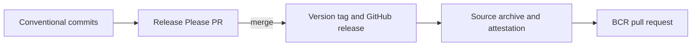

# Releasing

Release Please updates `version.txt` and the root manifest from Conventional
Commits. Keep `MODULE.bazel` version blank; BCR publication patches it to the
release version. `0.0.0` is the unreleased bootstrap state.

## Setup

Repository secrets must be configured by a maintainer:

- `GH_RELEASE_TOKEN`: Classic PAT with `repo` and `workflow` scopes. Release
  Please uses it so the version tag triggers the release workflow.
- `BCR_PUBLISH_TOKEN`: Classic PAT with `repo` and `workflow` scopes; its account
  must push to `formatjs/bazel-central-registry` and open the upstream PR.

No credentials are included in this repository. Secrets are prerequisites for
release automation; creating the workflows does not publish a release.

## Publish

Confirm main CI and the consumer smoke tests pass, no release run is active,
and the proposed version is expected. Merge the Release Please PR to approve
that version. The tag triggers `release.yaml`, which creates an archive and
attestation, then calls `publish.yaml` to open the BCR PR.

Completion requires the GitHub release assets, attestations, and an open BCR PR.
Do not invent a version or push a tag manually.

## Recover

- Missing release PR: dispatch `release-please.yml` on main.
- Existing tag missing assets: dispatch `release.yaml` with `tag_name`.
- Existing release missing BCR publication: dispatch `publish.yaml` with the
  existing `tag_name`.
- Rejected BCR token: rotate `BCR_PUBLISH_TOKEN`, retry publication with the same
  tag. Do not create another release.
