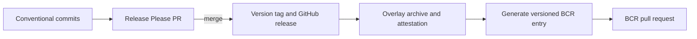

# Releasing

Versions follow the pinned Hermes source, using
`npm/hermes-compiler/package.json`. For untagged `static_h` snapshots, append the
first nine commit characters, matching
[upstream's version script](https://github.com/facebook/hermes/blob/393a539e645944a6ce879afc18ea8ddaa9232a08/utils/scripts/hermes/version-utils.js).
The current proposal is `260318099.0.0-393a539e6`.

Overlay-only revisions append `.bcr.N`, starting at `.bcr.1`. For example,
`260318099.0.0-393a539e6.bcr.1` keeps the same upstream source. An upstream update
starts a new version from that source's package metadata and commit. For a tagged
upstream release, use its package version without the snapshot hash; remove
`--snapshot` from the version test and set `prerelease` to false.

Set `release-as` in `release-please-config.json` before each new release.
Conventional Commits supply its changelog. `//tests/version:version_test` checks
the proposal against the pinned package metadata and commit. Snapshot releases
retain GitHub prerelease status.

`//tools/release:release` runs pinned Release Please with the Simple file updater.
Its version adapter preserves `.bcr.N` through PRs, changelogs, manifests, and tags.
Only a merged release PR matching `release-as` can publish. Once the manifest
records that proposal, later runs do not open another PR for it.
The private pnpm package extension supplies `git-file-utils`' undeclared runtime
dependency on `@octokit/request-error`; lifecycle scripts stay disabled.

Release Please updates `version.txt` and the root manifest only through its
release PR. Their `0.0.0` value is unreleased bootstrap state. Keep `MODULE.bazel`
version blank; publication stamps the BCR module templates.

## Setup

Use these `formatjs` organization secrets:

- `GH_RELEASE_TOKEN`: Classic PAT with `repo` and `workflow` scopes. Release
  Please uses it so the version tag triggers the release workflow.
- `BCR_PUBLISH_TOKEN`: Classic PAT with `repo` and `workflow` scopes; its account
  must push to `formatjs/bazel-central-registry` and open the upstream PR.

Their access policy must include `formatjs/hermes`; public-repository visibility
covers it. Workflows read them through the `secrets` context.

## Publish

Confirm main CI and the consumer smoke tests pass, no release run is active,
and the proposed version is expected. Merge the Release Please PR to approve
that version. The tag triggers `release.yaml`, which creates an overlay archive
and attestation, then calls `publish.yaml`. Publication generates the versioned
entry with `//tools/bcr:stage`, attests it, and opens the BCR PR. `source.json`
uses the upstream
archive and checksum from `repositories.bzl`; `overlay/` carries the Bazel files.
Consumers do not download the overlay release archive or fetch a second source
repository. Root `MODULE.bazel` stays blank; the overlay module is versioned.

Before proposing a release, update the maintained `bcr/overlay/` and patches
where needed. Match `HERMES_VERSION` to `release-as`; update the upstream commit
and checksum when changing Hermes. Keep both module templates blank. Validate
with `bazel run //tools/bcr:validate`; CI builds the generated entry directly.
Staging stamps module versions, hashes every overlay and patch, and preserves
existing registry entries and yank records. Historical snapshots stay in BCR
and release tags; no version directories need committing.

Completion requires the GitHub release assets, attestations, and an open BCR PR.
Do not invent a version or push a tag manually.

## Recover

- Missing release PR: dispatch `release-please.yml` on main.
- Existing tag missing assets: dispatch `release.yaml` with `tag_name`.
- Existing release missing BCR publication: dispatch `publish.yaml` with the
  existing `tag_name`.
- Rejected BCR token: rotate `BCR_PUBLISH_TOKEN`, retry publication with the same
  tag. Do not create another release.
